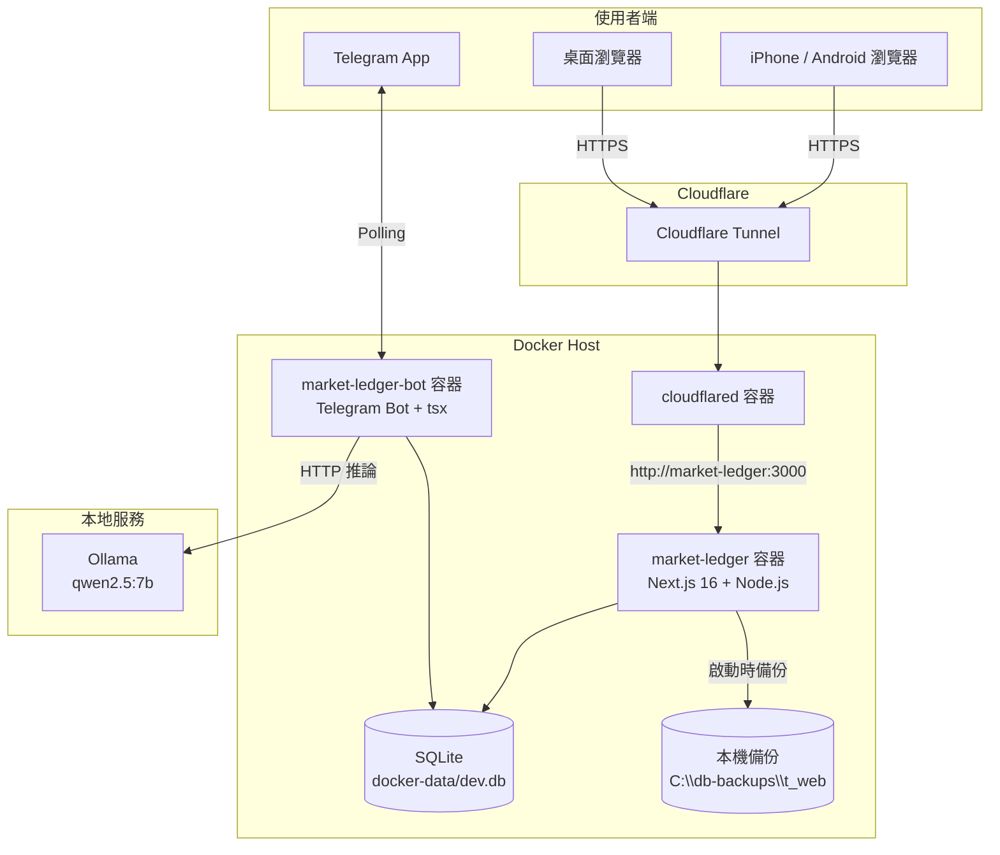
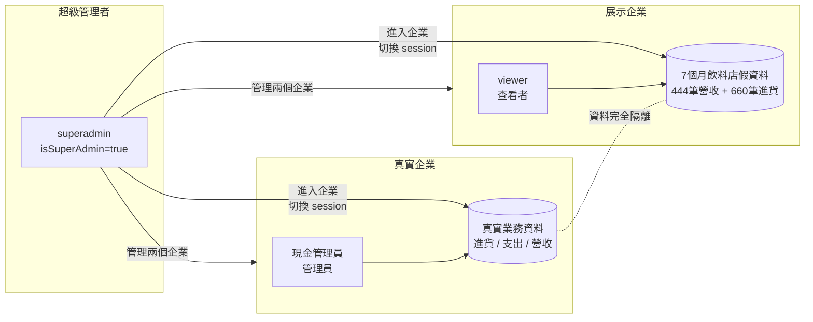
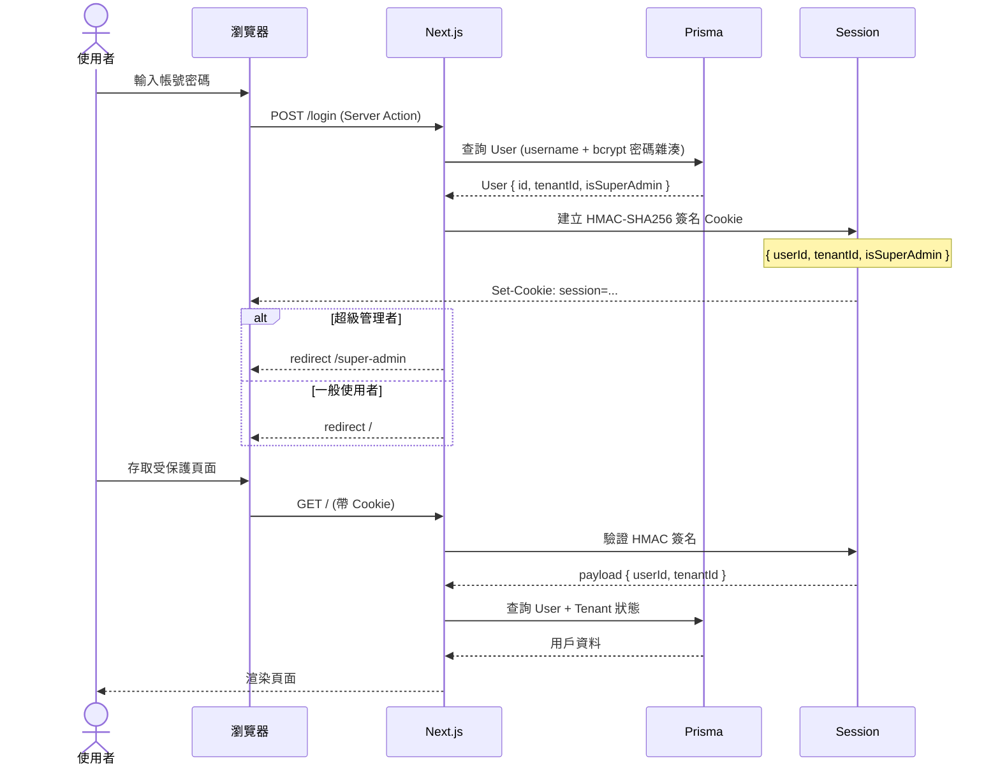
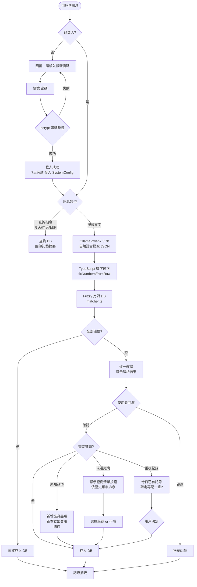
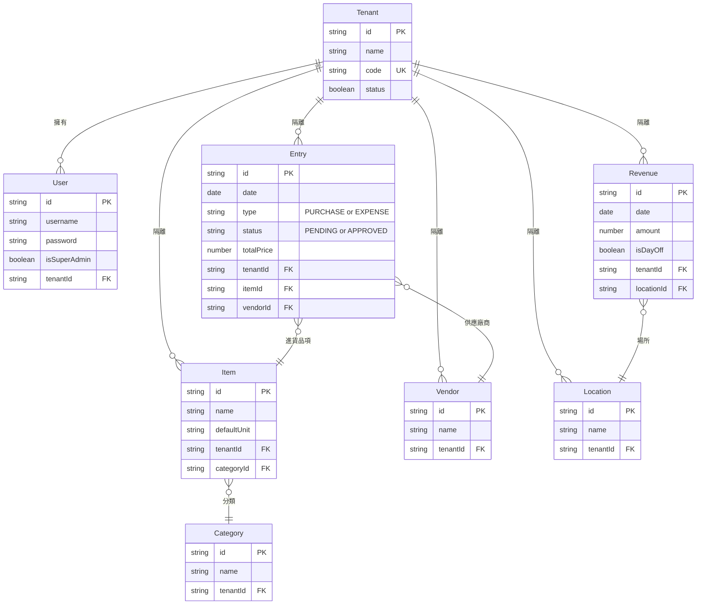

# 進貨存管系統

多租戶進銷存與營收管理平台，專為餐飲、零售、攤商設計。支援多企業隔離、行動裝置原生體驗，可透過 Cloudflare Tunnel 公開存取。

---

## 技術架構

| 層次 | 技術 |
|------|------|
| 前端框架 | Next.js 16 (App Router) + React 19 |
| 樣式 | Tailwind CSS v3 + Radix UI (shadcn/ui) |
| 資料庫 | SQLite（本機）via Prisma 5.22 |
| 認證 | bcrypt 密碼雜湊 + HMAC-SHA256 簽名 Cookie Session |
| 部署 | Docker Compose + Cloudflare Tunnel |
| 圖表 | Recharts |
| 機器人 | Telegram Bot（node-telegram-bot-api，polling 模式） |
| 本地 LLM | Ollama（qwen2.5:7b）自然語言解析 |

---

## 系統架構圖



---

## 多租戶架構

每個企業（Tenant）的資料完全隔離：所有業務資料表均含 `tenantId` 欄位，查詢時強制過濾。

本專案使用兩個獨立企業：
- **真實企業**：內部實際使用，現金管理員帳號由 `.env` 設定
- **展示企業**：對外展示用，唯讀帳號 `viewer`，使用飲料店假資料



---

## 認證流程



---

## Telegram Bot 自然語言記帳

透過 Telegram 傳送中文語音轉文字或手打記帳訊息，Bot 自動解析、比對資料庫並儲存，與 Web UI 共用同一 SQLite 資料庫即時同步。

### Bot 記帳流程



### 支援輸入格式

```
# 進貨（多行）
全頭皮3個360廠商甲
肝連 2.6臺斤 218 廠商甲
五花肉 5000 2.7斤 廠商乙

# 支出
薪資1220備註小明
清潔費110備註潮州

# 營業額
潮州攤 12800

# 查詢
今天記了什麼
3/3 的記錄
```

### 新品項/廠商建立流程

- **未知品項**：Bot 提供 [新增為進貨品項] / [新增為支出費用] / [略過] 三選一
- **進貨品項**：選擇分類後即建立並記錄
- **未知廠商**：提供 [新增廠商] / [不填廠商] 選擇
- **未指定廠商**：顯示全部廠商按鈕（依歷史頻率排序）供快速選擇

---

## 資料庫 ER 圖（核心模型）



---

## 目錄結構

```
t_web/
├── bot/                            # Telegram Bot（獨立 Node.js 進程）
│   ├── index.ts                    # Bot 主入口（polling 模式、狀態機）
│   ├── types.ts                    # TypeScript 型別（ParsedEntry, ChatState...）
│   ├── auth.ts                     # 會話管理 + bcrypt 登入驗證
│   ├── parser.ts                   # Ollama LLM 解析 + 數字後處理
│   ├── matcher.ts                  # Fuzzy 比對 DB + 廠商推斷 + 重複偵測
│   ├── state.ts                    # In-memory 狀態機
│   └── handlers/
│       ├── entry.ts                # 進貨/支出存入 DB
│       └── query.ts                # 查詢今日/歷史記錄
├── prisma/
│   ├── schema.prisma               # 資料庫模型定義
│   └── seed.ts                     # 初始資料 (角色、super admin)
├── scripts/
│   ├── backup-db.ts                # 每日備份腳本（啟動時執行）
│   └── seed-demo-data.ts           # 展示用假資料（viewer 帳號用）
├── src/
│   ├── app/
│   │   ├── (protected)/            # 一般用戶功能（需登入）
│   │   │   ├── page.tsx            # 首頁儀表板
│   │   │   ├── entry/new/          # 新增進貨/支出
│   │   │   ├── inventory/          # 進貨記錄列表
│   │   │   ├── revenue/            # 每日營收記帳
│   │   │   ├── reports/            # 報表與分析
│   │   │   └── settings/
│   │   │       └── users/          # 使用者管理（新增/編輯角色/停用/刪除）
│   │   ├── (super-admin)/          # 超級管理者後台
│   │   │   └── super-admin/
│   │   │       ├── page.tsx        # 系統總覽
│   │   │       └── tenants/        # 企業管理 CRUD
│   │   ├── actions/                # Next.js Server Actions
│   │   └── login/                  # 登入頁面
│   ├── components/
│   │   ├── layout/
│   │   │   └── MobileNav.tsx       # 底部導覽列（iOS Safe Area 支援）
│   │   └── ui/                     # shadcn/ui 元件
│   └── lib/
│       ├── auth.ts                 # 認證邏輯、getCurrentUser
│       ├── session.ts              # Cookie Session 簽名/驗證
│       └── prisma.ts               # Prisma Client 單例
├── docker-compose.yml              # Docker 部署配置（App + Bot + Tunnel）
├── Dockerfile
└── Dockerfile.cloudflared
```

---

## 使用者角色

| 角色 | 代碼 | 權限 |
|------|------|------|
| 超級管理者 | ─ | 管理所有企業、進入任意企業、重設密碼 |
| 管理員 | admin | 所有功能 + 系統設定 |
| 操作員 | write | 新增/編輯進貨、營收記帳 |
| 查看者 | read | 僅查看儀表板、報表 |

### 使用者管理功能（`/settings/users`）

管理員可對同企業內的其他帳號執行以下操作：

| 操作 | 說明 |
|------|------|
| 新增使用者 | 設定帳號、密碼、部門、角色 |
| 編輯角色 | 將現有帳號的角色切換為讀取者 / 操作員 / 管理員 |
| 停用 / 啟用 | 帳號停用後無法登入，但資料保留 |
| 刪除 | 永久刪除帳號（需二次確認） |

> 管理員無法對自己的帳號執行上述操作；若需修改自身角色，須由另一位管理員或超級管理者處理。

---

## 備份策略

- **啟動時自動備份**：每次 `npm start` 或 `start:lan` 時執行 `scripts/backup-db.ts`
- **每日一次**：若當天已備份則跳過，避免重複
- **備份位置**：`C:\db-backups\t_web\dev_db_YYYYMMDD_HHMMSS.db`
- **保留策略**：
  - 最近 14 天：全部保留
  - 14 天 ~ 8 週：每週保留一份
  - 8 週 ~ 12 月：每月保留一份

---

## 快速開始

### 開發環境

```bash
# 安裝相依套件
npm install

# 建立環境變數
cp .env.example .env

# 資料庫初始化（與正式環境相同機制：prisma db push，見下方「資料庫結構管理」）
npx prisma db push
npx prisma db seed   # 開發環境會產生隨機密碼並只印一次；正式環境見下方「Seed 與預設帳號」

# 啟動開發伺服器
npm run dev
```

### 正式部署（Docker）

```bat
# 啟動（備份 DB → 建置 image → 啟動 App 容器）
start.bat

# 停止 App（Cloudflare Tunnel 保持運行）
stop.bat

# 查看 logs
docker compose logs -f market-ledger
```

> **注意**：Cloudflare Tunnel 容器（`market-ledger-tunnel`）須持續運行以維持對外連線，`stop.bat` 只停止 App，不停 Tunnel。

### 資料庫結構管理（db push 才是正式機制）

正式環境（容器開機時 `docker-start.sh`）使用 **`prisma db push`** 同步結構，**不是** `prisma migrate deploy`。
`prisma/migrations/` 只是歷史紀錄 / 參考，**不會**在正式環境執行，也**不要刪除**。若要改用
`migrate deploy`，必須先對 live DB 做 baseline（`prisma migrate resolve`），這是獨立的變更，不要順手改。
（T-ML-037：`20260614_add_cash_count/migration.sql` 內一個含真實姓名的 `DEFAULT` 字面值已改為 `DEFAULT ''`；
該檔僅供參考，對 live DB 沒有影響。）

### Seed 與預設帳號

- 容器首次啟動會跑一次 `prisma/seed.ts`（image 內含 tsx）。**程式碼內沒有任何預設密碼。**
- 正式環境（`NODE_ENV=production`）下，`SUPER_ADMIN_PASSWORD`、`ADMIN_PASSWORD`、`CASH_ADMIN_PASSWORD`、
  `CASH_EMPLOYEE_PASSWORD` 任一未設，seed 會拒絕執行（exit 2）。
- seed 只「建立」不存在的使用者，**不會**覆蓋既有使用者的密碼或狀態。
- seed 失敗時容器不會 crash-loop（網站與既有資料照常服務），但會大聲記錄，且不寫 `.seeded`，下次容器啟動會重試。
- 開發環境未設這些變數時，會產生隨機密碼並只在 console 印一次。

### 容器與權限

web 與 bot 容器都以非 root 的 `node` 使用者執行。entrypoint（`docker-start.sh` / `docker-bot-start.sh`）
先以 root 啟動，只為了把 named volume `market-ledger-data` 內既有（root 擁有）的檔案 chown 給 `node`，
然後用 `setpriv` 降權後 re-exec。bot 容器只拿到它需要的環境變數，不再載入整個 `.env`。

### Cloudflare tunnel

隧道設定（UUID、對外網域）不放在公開 repo。`docker-compose.yml` 從 `.env` 產生 cloudflared 設定，
只掛載該隧道的憑證 json（不再掛整個 `~/.cloudflared`，那裡有帳號層級的 `cert.pem`）。`.env` 需要：

| 變數 | 說明 |
|------|------|
| `CLOUDFLARED_DIR` | 放隧道憑證 json 的資料夾 |
| `TUNNEL_ID` | 隧道 UUID（憑證檔名為 `<TUNNEL_ID>.json`）|
| `TUNNEL_HOSTNAME_MAIN` | 主站網域 |
| `TUNNEL_HOSTNAME_CASH` | 現金清點 PWA 子網域 |

映像固定版本 `cloudflare/cloudflared:2026.3.0`；要升級請改 tag 並測試。`Dockerfile.cloudflared` 已棄用，不使用。

### claude-bridge

Telegram bot 透過 host 上的 `scripts/claude-bridge`（只綁 127.0.0.1）呼叫 `claude -p`。設定 `CLAUDE_BRIDGE_TOKEN`
等細節見 `scripts/claude-bridge/README.md`。

### CI 與測試

`.github/workflows/ci.yml` 於 push / PR 執行 `npm ci`、`prisma generate`、`tsc --noEmit`、`npm run lint`、
`npm audit --omit=dev --audit-level=critical` 與不需要真實 DB 的單元測試。
`npm run test` 會自動探索 `bot/ src/ scripts/` 下所有 `*.test.ts|js`；`TEST_SKIP_DB=1` 略過需要真實資料的測試
（清單在 `scripts/run-tests.ts` 的 `DB_TESTS`）。

---

## 展示帳號

> 以下帳號開放給外部人員瀏覽展示用，資料涵蓋 2025-07-01 ～ 2026-02-07（飲料店業態，7 個月共 444 筆營收 + 660 筆進貨/支出）

| 用途 | 帳號 | 密碼 | 角色 |
|------|------|------|------|
| 展示查看（唯讀） | viewer | viewer123 | 查看者 |

> 管理員帳號不公開，如需存取請聯絡系統負責人。

---

## 環境變數

| 變數 | 說明 | 範例 |
|------|------|------|
| `DATABASE_URL` | SQLite 路徑 | `file:./prisma/dev.db` |
| `SESSION_SECRET` | Session 簽名金鑰（至少 32 字元） | 隨機字串 |
| `CLOUDFLARED_DIR` | cloudflared 憑證目錄 | `C:/Users/xxx/.cloudflared` |
| `TELEGRAM_BOT_TOKEN` | Telegram Bot Token（BotFather 取得） | 請勿公開 |
| `OLLAMA_BASE_URL` | Ollama 服務位址 | `http://localhost:11434` |
| `OLLAMA_MODEL` | 使用的 LLM 模型 | `qwen2.5:7b` |
| `SUPER_ADMIN_PASSWORD` / `ADMIN_PASSWORD` / `CASH_ADMIN_PASSWORD` / `CASH_EMPLOYEE_PASSWORD` | 首次 seed 的帳號密碼（正式環境必填，無預設值）| 隨機字串 |
| `CLAUDE_BRIDGE_TOKEN` | host 端 claude-bridge 與 bot 共用的 Bearer token | 隨機字串 |
| `TUNNEL_ID` / `TUNNEL_HOSTNAME_MAIN` / `TUNNEL_HOSTNAME_CASH` | Cloudflare 隧道設定（見上方）| — |

> **注意**：請將 `.env` 加入 `.gitignore`，切勿將 Token 或 Secret 提交至版本控制。

---

## 行動裝置支援

- **iOS Safe Area**：底部導覽列自動適應 iPhone 的 Home Indicator 空間
- **防縮放**：輸入欄位字型大小 ≥ 16px，防止 iOS 自動縮放
- **觸控優化**：所有互動元素觸控區域 ≥ 44×44px（Apple HIG 標準）
- **PWA 支援**：可加入 iPhone 主畫面，以獨立 App 模式運行
- **Viewport Fit**：支援瀏海/動態島 iPhone 的全螢幕顯示
